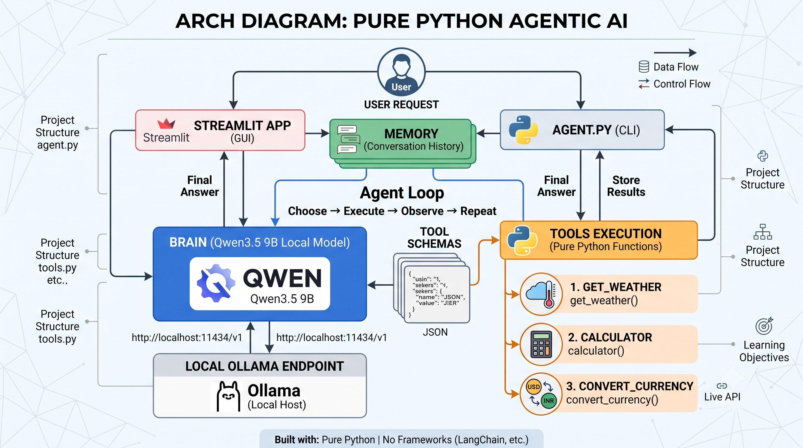
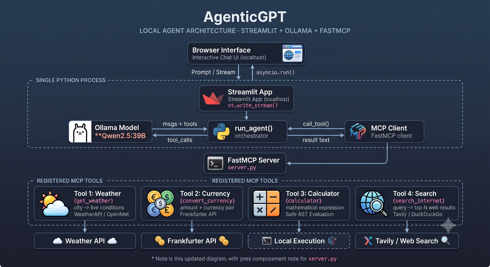

# AgenticGPT

A tool-calling AI agent written in **pure Python** — no LangChain, no LangGraph, no CrewAI, no AutoGen.

This repository is both a working agent and a record of how it got there. Each
architectural stage is preserved and still runnable, so the progression from
*hardcoded tools* to *dynamically discovered tools over MCP* can be read as
code rather than described in prose.

Link:https://agenticailearning-jzetjkymtkh9wkgqvtposs.streamlit.app/

---

## Contents

1. [What AgenticGPT is](#what-agenticgpt-is)
2. [Why pure Python](#why-pure-python)
3. [What frameworks hide](#what-frameworks-hide)
4. [Version 1 — direct Python tools](#version-1--direct-python-tools)
5. [Version 2 — MCP tool discovery](#version-2--mcp-tool-discovery)
6. [Current architecture](#current-architecture)
7. [Repository structure](#repository-structure)
8. [Setup](#setup)
9. [Running it](#running-it)
10. [Running the historical versions](#running-the-historical-versions)
11. [Worth knowing](#worth-knowing)
12. [Roadmap](#roadmap)

---

## What AgenticGPT is

An agent that takes a question, decides whether it needs a tool, runs the tool,
reads the result, and either answers or goes round again.

```text
Question  →  choose an action  →  execute  →  observe  →  decide again  →  answer
```

A chatbot is `question → answer`. That extra middle is the entire difference,
and it is about forty lines of Python in [`agent/loop.py`](src/agenticgpt/agent/loop.py).

Today it can look up the weather, convert currencies at live rates, evaluate
arithmetic, and search the web — but the tools are the least interesting part.
They are there to have something for the loop to call.

## Why pure Python

Because the goal is to understand agents, not to ship one fast.

A framework gets you a working agent in twenty lines and leaves you unable to
explain any of them. Written out by hand, every mechanism is visible and every
failure is debuggable: when the model returns a malformed tool call, you are
reading your own code, not stepping through someone else's abstraction.

The constraint is deliberate and permanent: **the agent runtime stays pure
Python.** The one dependency that matters is `fastmcp`, and it is here because
MCP is the protocol being studied — not because it supplies an agent.

## What frameworks hide

Four things, all of them worth seeing once:

| Hidden | What it actually is |
|---|---|
| "The model calls your function" | It returns a **name and a JSON blob**. Everything after that is your code. |
| Tool schemas | JSON descriptions shipped in the context window on **every** request. |
| Memory | A Python list of message dicts. There is no other state. |
| The agent loop | A `for` loop with a turn limit, because nothing else stops it. |

Two provider details surfaced only because the loop was hand-written:
**Ollama returns tool arguments as a dict, Groq returns them as a JSON string**,
and Ollama accepts a `tool_name` key on tool results while Groq requires
`tool_call_id`. A framework would have smoothed both over — and the lesson with them.

---

## Version 1 — direct Python tools

Preserved in [`versions/v1_direct_tools/`](versions/v1_direct_tools/).

```text
V1
Agent
 ↓
Hardcoded Tool Registry     (TOOLS_BY_NAME dict)
 ↓
Python Functions
```



The agent imports its tools. `TOOL_SCHEMAS` is hand-written JSON describing
what the model may call; `TOOLS_BY_NAME` maps the name that comes back to the
function that runs it. Everything happens in one process.

It works, and it does not scale. The schema and the function it describes are
two separate things that drift apart. Adding a tool means editing three places.
Nothing else can use these tools, because they are just functions in a file.

## Version 2 — MCP tool discovery

Preserved in [`versions/v2_mcp_tools/`](versions/v2_mcp_tools/).

```text
V2
Agent
 ↓
MCP Client
 ↓
MCP Server
 ↓
Dynamically Discovered Tools
```



The tools move out into their own process, and the agent stops importing them.
It asks — `client.list_tools()` — and finds out at run time what exists.

| | Version 1 | Version 2 |
|---|---|---|
| Tool wiring | `TOOLS_BY_NAME` dict | discovered via `list_tools()` |
| Tool schemas | hand-written JSON | generated from type hints and docstrings |
| Execution | direct Python call | `await client.call_tool()` over stdio |
| Tool process | same process as the agent | separate subprocess |
| Calculator | raw `eval()` | AST walker, arithmetic only |

Adding a tool becomes: write one decorated function. No schema, no registry, no
frontend change. And because MCP is a protocol rather than a convention, the
same server works with any MCP client — Claude Desktop included.

What it costs: a subprocess spawn per message, and the tool schemas re-sent on
every turn.

## Current architecture

The active codebase is [`src/agenticgpt/`](src/agenticgpt/). Version 2 proved
the idea in a single module where the agent loop and the MCP client shared a
file; this pulls them apart along the seams that matter.

```text
AgenticGPT
     ↓
MCP Manager
     ↓
Multiple MCP Servers
     ↓
Tools + Resources + Prompts
```

Four layers, each ignorant of the one below:

```text
apps/                  user interfaces — Streamlit, CLI
    ↓
agenticgpt.agent       reasoning: the loop, the message list, the model
    ↓
agenticgpt.mcp         MCP client: config, connections, registry, manager
    ↓
agenticgpt.servers     MCP servers: tools, resources, prompts
```

The rules that keep it honest:

- The **agent** does not know how any tool is implemented, or which server owns
  it. It calls `await toolbox.call_tool(name, arguments)` and reads text back.
- The **MCP client** contains no reasoning. Sessions, transports and payloads only.
- The **MCP server** contains no UI and no agent code. It would work driven by
  any other MCP client.
- The **Streamlit app** implements no runtime. It renders, and calls `run_agent()`.

| Module | Responsibility |
|---|---|
| [`agent/loop.py`](src/agenticgpt/agent/loop.py) | the loop: ask, detect tool calls, execute, append, decide when to stop |
| [`agent/messages.py`](src/agenticgpt/agent/messages.py) | the message list — system, user, assistant and tool messages |
| [`agent/llm.py`](src/agenticgpt/agent/llm.py) | provider-specific request/response handling (Ollama, Groq) |
| [`mcp/client.py`](src/agenticgpt/mcp/client.py) | one connection to one server: lifecycle, discovery, execution |
| [`mcp/manager.py`](src/agenticgpt/mcp/manager.py) | coordinates every server behind one `call_tool()` |
| [`mcp/registry.py`](src/agenticgpt/mcp/registry.py) | what was discovered, and which server owns each capability |
| [`mcp/config.py`](src/agenticgpt/mcp/config.py) | where servers are declared — the only place that knows a path or a URL |
| [`servers/workspace/`](src/agenticgpt/servers/workspace/) | the bundled MCP server: one module per tool |

Future milestones evolve **inside `src/agenticgpt/`**. There will be no `v3/`
directory — Git commits and tags carry the history from here.

---

## Repository structure

```text
AgenticAILearning/
│
├── README.md
├── pyproject.toml              the active project's only dependency file
├── .env.example
│
├── docs/
│   └── architecture/
│       ├── v1-direct-tools.png
│       ├── v2-mcp-tools.png
│       └── learning-journey.png
│
├── versions/                   preserved, runnable, not developed further
│   ├── v1_direct_tools/        agent.py · tools.py · app.py
│   └── v2_mcp_tools/           app.py · server.py · client.py · streamlit_app.py
│
├── src/
│   └── agenticgpt/             ← the active codebase
│       ├── __init__.py         run_agent(), discover_tools(), the CLI entry point
│       ├── agent/              loop.py · messages.py · llm.py
│       ├── mcp/                client.py · manager.py · registry.py · config.py
│       └── servers/
│           └── workspace/      server.py · tools/ · resources/ · prompts/
│
├── apps/
│   └── streamlit_app.py        UI only — no agent logic lives here
│
└── tests/
```

---

## Setup

```bash
git clone https://github.com/akshatDE/AgenticAILearning.git
cd AgenticAILearning
python -m venv .venv && source .venv/bin/activate
pip install -e ".[ui]"
```

The package then imports as `agenticgpt` from anywhere, and `agenticgpt`
is on your PATH as a command.

Copy `.env.example` to `.env` and fill in the keys you want (both are free
tiers; every tool degrades to a readable message without one):

```text
WEATHER_API_KEY=your_weatherapi_key
TAVILY_API_KEY=your_tavily_key
```

Nothing reads a key at import time and nothing is hardcoded — the MCP server is
spawned as a child process and inherits the environment from whoever started
the agent. `.env` is git-ignored.

Then pull a model and start Ollama:

```bash
ollama pull qwen3:8b
ollama serve
```

## Running it

The Streamlit UI:

```bash
streamlit run apps/streamlit_app.py
```

The CLI:

```bash
agenticgpt
```

From Python:

```python
import asyncio
from agenticgpt import run_agent

print(asyncio.run(run_agent("Convert 500 USD to INR and divide the result by 4")))
```

The MCP server starts itself — the client spawns it over stdio. There is no
second terminal.

Tests:

```bash
pip install -e ".[dev]"
pytest
```

They cover the loop with a scripted model, the registry's routing, the
calculator's refusal to be an interpreter, and the whole stack end to end over
a real MCP subprocess. None of them need Ollama or a network.

Example prompts:

```text
What is the weather in Tokyo?
Convert 100 USD to INR.
Calculate (250 * 12) / 5.
Convert 500 USD to INR and divide the result by 4.
```

The last one needs two tool calls, so the trace shows the loop going round more
than once.

## Running the historical versions

Both are independent of the active package and of each other.

**Version 1** — Groq in the cloud, or Ollama locally:

```bash
cd versions/v1_direct_tools
pip install -r requirements.txt
python agent.py
```

```bash
streamlit run versions/v1_direct_tools/app.py
```

`agent.py` uses Groq by default and needs `GROQ_API_KEY`. Groq exists here
because a 9B model cannot be hosted on free infrastructure, which is what made
a live demo possible:
**[try it →](https://akshatde-agenticailearning-pure-python-local-agentapp-qgqnq1.streamlit.app/)**

**Version 2** — MCP over stdio, Ollama only:

```bash
cd versions/v2_mcp_tools
pip install -r requirements.txt
python app.py
```

```bash
streamlit run versions/v2_mcp_tools/streamlit_app.py
```

To poke at the V2 server without an agent: `python versions/v2_mcp_tools/client.py`.

---

## Worth knowing

**The tool schemas ride in the context window on every request.** Ollama is
stateless per call, so each turn re-sends the full message list plus every tool
definition. Four tools is roughly 400–700 tokens of overhead per turn. What
actually grows is the history — one `search_internet` call can append a few
thousand tokens that then travel with every later turn.

**The FastMCP banner appears once per message.** That is the subprocess booting.
It goes to stderr, so it cannot corrupt the JSON-RPC stream on stdout. Silence
it with `mcp.run(show_banner=False)`.

**The default system prompt is restrictive.** `DEFAULT_SYSTEM_PROMPT` in
`agent/loop.py` limits the model to greeting the user and using the provided
tools; anything else gets a polite refusal. Override it with
`AgentLoop(system_prompt=...)`, or pass `None` for no system message.

**The calculator will not use `eval()`.** Its expression comes from the model,
which is influenced by user input and — through `search_internet` — by the
contents of web pages. `eval()` on that path is arbitrary code execution, so it
parses and walks the AST instead, permitting numbers and `+ - * / // % **` only.

**Current limitations.** No conversation memory across turns; a new server
subprocess per message; sequential tool execution; answers streamed
cosmetically rather than token by token; and Ollama has to run on the same
machine.

## Roadmap

Near term, inside `src/agenticgpt/`:

- thread the chat history into the loop for real conversation memory
- a system prompt worth having
- keep one MCP session alive on a background event loop instead of per message
- true token streaming from `/api/chat`
- SQLite conversation persistence

On the MCP side, the layers are already in place for:

- **more servers** — a second entry in `mcp/config.py`, and `MCPManager` routes
  to it; the agent does not change
- **resources** — readable things the client fetches by URI, not just tools
- **prompts** — server-owned templates, so a server ships the wording that gets
  the best out of its own tools
- **remote servers** — `MCPServerConfig` already carries a `transport` field;
  HTTP is the other value
- a file-reading and SQL server, toward a data engineering agent

---

## Core concepts

1. **Brain** — the model, deciding what to do
2. **Tools** — functions that act on the world
3. **Tool schemas** — how the model learns what exists (hand-written in V1, discovered in V2)
4. **Memory** — the message list
5. **Agent loop** — choose → execute → observe → repeat

---

## Author

**Akshat Sharma**

Data Engineering · Python · Local LLMs · Agentic AI
